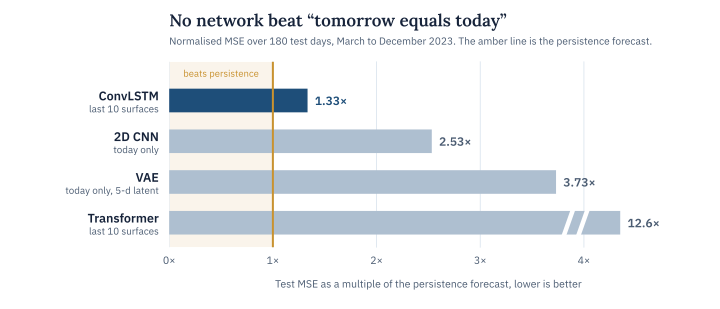
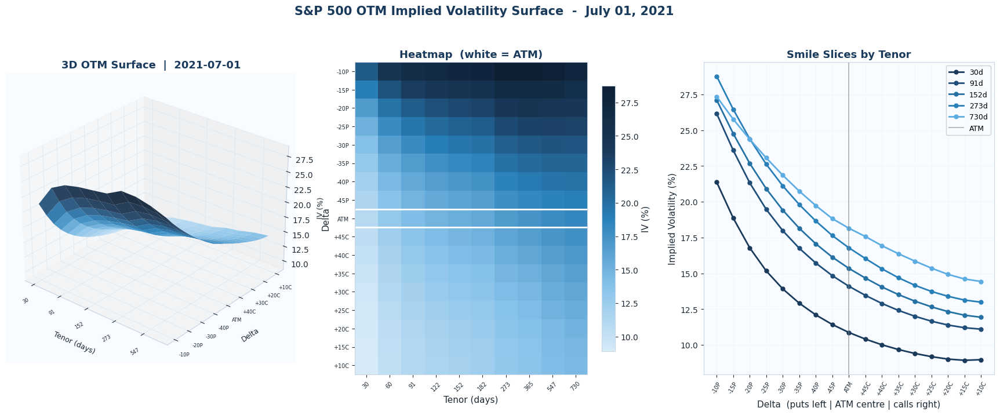
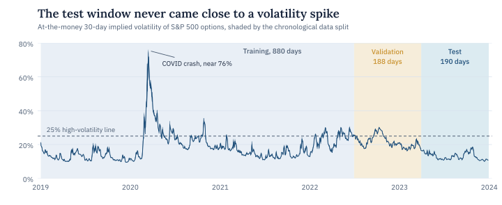
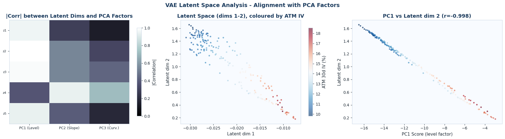
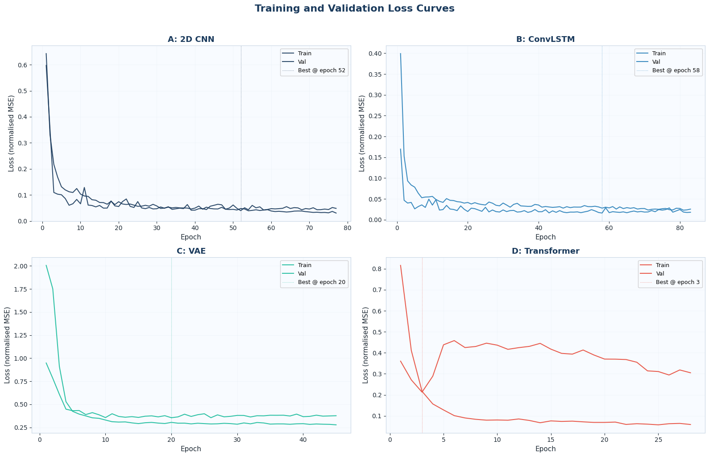
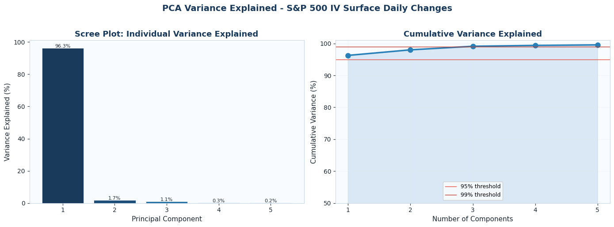
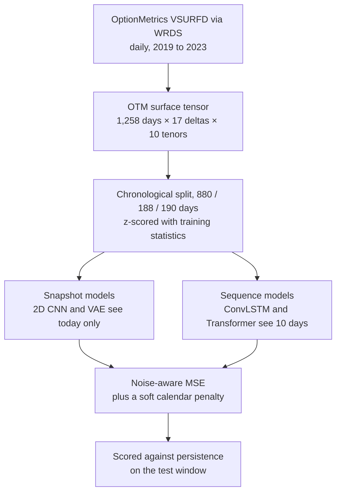

<p align="center">
  
</p>

<p align="center">
  
  
  
  
</p>

Every trading day, thousands of S&P 500 option quotes boil down to one object, the implied volatility surface. It shows what the market charges for protection at every strike and maturity, so a good forecast of tomorrow’s surface is worth a lot to anyone who prices or hedges options.

I wanted to find out whether deep learning can make that forecast one day ahead, and which design choice actually matters when it tries. I built four networks that each bet on a different source of signal and trained them on five years of daily OptionMetrics surfaces. Then I held every one of them to the hardest benchmark in this area, the forecast that tomorrow will look exactly like today.

> **In short.** None of the four networks beat “no change” on mean squared error, but the ConvLSTM, which reads the last ten days, came closest and roughly halved the CNN’s error. Along the way the surface turned out to be close to linear and very low-dimensional, and the Transformer showed how fast attention overfits on 870 training sequences.

## Key findings

| Finding | Evidence |
| :-- | :-- |
| Tomorrow’s surface is very hard to beat | Persistence scored a normalised test MSE of 0.00595. The best network, the ConvLSTM, scored 0.00794, which is 1.33 times higher |
| Looking back ten days helps | The ConvLSTM reads the last ten surfaces and finished with roughly half the CNN’s error (0.00794 against 0.01507) using a sixth of the parameters |
| The surface lives in very few dimensions | The first principal component of daily changes explains 96.3% of the variance, and three components explain 99.1% |
| A nonlinear model rediscovered PCA | The VAE’s second latent dimension tracks the first principal component with r = −0.998 |
| Attention needs much more data | The Transformer’s validation loss was lowest at epoch 3 and had doubled by epoch 10 while its training loss kept falling |
| The forecasts respect calendar no-arbitrage | All four models produced zero calendar-spread violations on the test set, with only a soft penalty in the loss |

<picture>
  <source media="(prefers-color-scheme: dark)" srcset="assets/results-dark.svg">
  
</picture>

## Conclusion

Daily changes in the S&P 500 surface are close to unpredictable in size. The level factor of those changes has a lag-one autocorrelation of −0.27, so most of what happens tomorrow is noise around today’s surface, and that is exactly the situation where “no change” is hard to beat on squared error.

That doesn’t make the networks useless. The one that looked back over two weeks clearly beat the one that only saw today, so the path the surface took to get here carries real information, and the fair yardstick for any new model is persistence rather than another network.

The geometry is also much simpler than 170 numbers suggest. The surface moves mostly as one block, and a VAE built to find curved structure ended up rebuilding PCA. Attention-based models need far more data than five years of one index can give them, while clean training data seems to teach calendar no-arbitrage without any hard constraint.

## The data

Daily S&P 500 implied volatility surfaces come from OptionMetrics IvyDB US (the VSURFD table, SECID 108105), pulled through WRDS for every trading day from 2 January 2019 to 29 December 2023. I kept only out-of-the-money options, so each day becomes a 17 by 10 grid with puts and calls from 10 to 45 delta on either side of the at-the-money point and ten maturities from 30 days to two years. The two 50-delta quotes are averaged into one at-the-money value, since put-call parity gives them the same implied vol. The pull returned 226,440 rows and no missing cells.



*One day from the sample, 1 July 2021. The put wing sits well above the call wing at every maturity, and on a calm day like this one longer maturities trade at higher vol.*

The split is strictly chronological. Normalisation statistics and the PCA basis are fitted on the training days only.

| Split | Trading days | Dates |
| :-- | --: | :-- |
| Training | 880 | 2 Jan 2019 to 29 Jun 2022 |
| Validation | 188 | 30 Jun 2022 to 29 Mar 2023 |
| Test | 190 | 30 Mar 2023 to 29 Dec 2023 |

<picture>
  <source media="(prefers-color-scheme: dark)" srcset="assets/timeline-dark.svg">
  
</picture>

That puts the COVID crash in training and leaves the test window in a calm market, where 30-day at-the-money volatility stayed under 20% the whole time. Keep that in mind when reading the results.

## The four models

Each model encodes one idea about where the predictive signal sits. All four see the same data and are trained the same way, so the differences come from the architecture.

| | Model | The bet it makes | Input | Parameters | Test MSE vs persistence |
| :-- | :-- | :-- | :-- | --: | --: |
| A | 2D CNN with separable residual blocks | Today’s shape already holds what tomorrow needs | Today’s surface | 2.89M | 2.53× |
| B | ConvLSTM | The path over the last two weeks adds signal | Last 10 surfaces | 464K | 1.33× |
| C | VAE with a latent forecaster | The surface lives on a low-dimensional manifold | Today’s surface | 2.84M | 3.73× |
| D | Transformer encoder | Attention can find similar past regimes | Last 10 surfaces | 364K | 12.6× |

Training used AdamW (learning rate 3e-4, weight decay 1e-4) with cosine annealing, batches of 64, gradient clipping at 1.0 and early stopping after 25 epochs without improvement. The loss is a noise-aware MSE that weights each cell by the inverse of its historical variance, so steady at-the-money cells count up to 24 times more than noisy wing cells. On top of that sits a soft penalty whenever total implied variance falls as maturity rises, which is what a calendar-spread arbitrage looks like. The VAE also carries reconstruction and KL terms in its loss.

### What each model taught me

The ConvLSTM is the only network that got close to persistence, and it did that with about 464 thousand parameters against the CNN’s 2.9 million. Knowing how the surface moved over the last ten sessions is worth something, which fits recent evidence that volatility depends on its own recent path (Guyon and Lekeufack, 2023).

The VAE had a nonlinear encoder and decoder and every chance to find curved structure. Its main latent dimension came back as the first principal component in disguise.



*On the left, how strongly each latent dimension correlates with the first three PCA factors. On the right, the second latent dimension against the PC1 score, with r = −0.998.*

For daily S&P 500 surfaces a handful of linear factors does the job, which agrees with Cont and da Fonseca (2002) from a completely different direction.

The Transformer is the cautionary tale. With about 870 training sequences it started memorising after three epochs, and its test error ended up more than twelve times the persistence error. That is a data problem more than an architecture problem.

<details>
<summary><b>Training curves for all four models</b></summary>
<br>


The CNN and ConvLSTM curves stay close together all the way through. The Transformer’s validation loss turns upward after epoch 3 while its training loss keeps dropping.

</details>

<details>
<summary><b>PCA of daily surface changes</b></summary>
<br>


The first component is a near-parallel shift of the whole surface and explains 96.3% of daily changes. The next two tilt the term structure (1.7%) and the skew (1.1%).

</details>

## How it fits together



## Limitations and next steps

The test window, 30 March to 29 December 2023, was calm, so these results say nothing about how the models behave in a crisis. Forecasts are one day ahead and each model was trained once, with a single seed. Only calendar arbitrage was checked on the predictions, so butterfly arbitrage is still an open question.

The notebook also reports directional accuracy and a simple volatility-trading signal. I’m re-running both after correcting how the sequence models’ forecasts line up in time, and I’ll add them here once that’s done.

Next I want to train with a loss that rewards getting the direction of the move right, predict SSVI parameters so the output is arbitrage-free by construction, pre-train a surface encoder on single-stock option surfaces so attention has enough data to work with, and test on a window that includes a real volatility spike.

## Running it

You’ll need a WRDS account with OptionMetrics access. The data is licensed, so it isn’t stored in this repository.

```bash
pip install wrds torch numpy pandas pyarrow scipy scikit-learn statsmodels matplotlib seaborn tqdm
jupyter notebook iv-surface-prediction-cnn-convlstm-transformers.ipynb
```

On the first run the notebook asks for your WRDS login and caches the pull as a parquet file. After that it runs end to end on a CPU in about an hour, most of it spent on the ConvLSTM at roughly 38 seconds per epoch.

## Repository

```text
.
├── iv-surface-prediction-cnn-convlstm-transformers.ipynb   the full study, from the WRDS pull to evaluation
├── assets/                                                 figures used in this README
└── README.md
```

## Further reading

| Reference | Why it matters here |
| :-- | :-- |
| Cont and da Fonseca (2002), *Dynamics of implied volatility surfaces*, Quantitative Finance | The factor view of surface dynamics that the VAE ended up reproducing |
| Shi et al. (2015), *Convolutional LSTM network*, NeurIPS | The architecture behind model B |
| Guyon and Lekeufack (2023), *Volatility is (mostly) path-dependent*, Quantitative Finance | Why recent history should help |
| Gatheral and Jacquier (2014), *Arbitrage-free SVI volatility surfaces*, Quantitative Finance | The no-arbitrage conditions and the SSVI idea in the next steps |

The full reference list is in Section 13 of the notebook.

## About

Made by Melissa Monfared, MSc Data Science at the London School of Economics. More projects live on [my website](https://melissamonfared.github.io). I also post notebooks on [Kaggle](https://kaggle.com/melissamonfared) and I’m on [LinkedIn](https://linkedin.com/in/melissamonfared).

Option data from OptionMetrics IvyDB US, accessed through Wharton Research Data Services.
